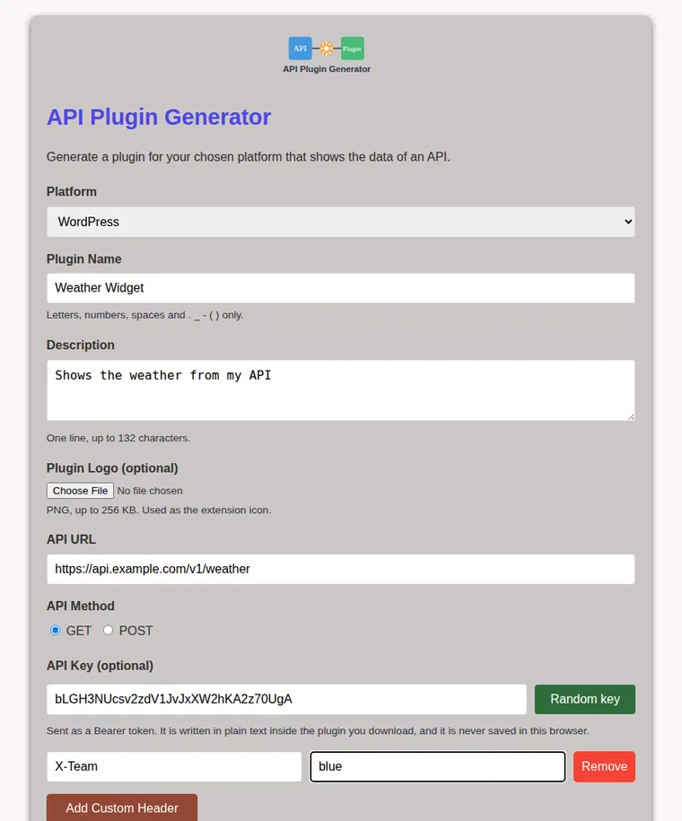

# API Plugin Generator

Generate a **WordPress plugin**, a **Chrome extension** or a **Firefox extension** that shows the data of an API, from a small web form. You describe the API (URL, method, key, headers), you download a ready-to-install zip.



## Features

- **Three platforms:** a WordPress plugin with a shortcode (and an optional "visualize" shortcode), a Chrome extension (Manifest V3) and a Firefox extension (Manifest V2).
- **Preview that is the real thing:** the preview is produced by the same code as the download, not by a copy of it.
- **Test API:** calls your API from the server and shows the answer (see [Security](#security) for what it will refuse).
- **Optional logo:** a PNG, used as the extension icon.
- **Saved configurations** in your browser, **never including the API key**.
- Everything is generated **in memory**: nothing is written to the server's disk.

## Quick start

```bash
npm install
npm run dev          # http://localhost:3000
```

Requires Node.js 20.9 or later to run the app, and Node.js 22.12 or later to run the tests.

| Command | What it does |
|---|---|
| `npm run dev` | development server |
| `npm run build` / `npm start` | production build and server |
| `npm test` | 162 tests (see below) |
| `npm run lint` | ESLint |
| `npm run typecheck` | TypeScript |

To test an API that runs on your own machine (`localhost`), start the server with `ALLOW_PRIVATE_URLS=true npm run dev`. This is off by default, on purpose.

## Security

This tool takes text from the user and (1) calls a URL from the server and (2) writes that text into code. Both are classic ways to get hurt, so each one is closed explicitly and covered by tests.

| Risk | Protection | Where it is tested |
|---|---|---|
| **The server is used to reach internal services** (SSRF): `localhost`, the private network, cloud metadata (`169.254.169.254`) | Only `http(s)` without credentials; internal host names refused; every private, reserved, IPv4-in-IPv6 (`::ffff:127.0.0.1`, NAT64, 6to4) and oddly written address (`2130706433`, `0x7f.1`) refused; the **address actually used for the connection** is checked, so a host name that changes its answer between the check and the connection (DNS rebinding) is refused too; redirects are never followed; 8 s timeout; 1 MB limit | `tests/ssrf.test.ts` (81 tests), `tests/routes.test.ts` |
| **User text becomes code** in the generated PHP or JavaScript | Every value is escaped for the language it is written into (PHP string, JS/JSON string, HTML); manifests are built as objects, not as text; method and platform are enumerations; names are reduced to a safe slug | `tests/generators.test.ts`: the generated WordPress plugin is **run with the real PHP interpreter** with hostile input, and the popup is **run in an isolated context** |
| **Path traversal** through the plugin name | The zip is created in memory and its file name is a slug of letters, digits and hyphens; the zip builder refuses any unsafe path | `tests/routes.test.ts` (a file outside is left untouched), `tests/generators.test.ts` |
| **Cross-site scripting in the generated plugins** | The extension popup uses `textContent`, never `innerHTML`; the WordPress shortcodes escape everything they print | `tests/generators.test.ts` |
| **Cross-site scripting in this interface** | Header names and values are inserted with the DOM API, not `innerHTML`; a Content Security Policy blocks inline scripts and external resources | an end-to-end browser test loads a malicious saved configuration |
| **Secrets in the browser** | The API key is never saved in `localStorage` | end-to-end browser test |
| **Invalid input** | A [zod](https://zod.dev) schema validates every field (lengths, characters, headers, logo signature and size) and the answer lists what is wrong | `tests/schema.test.ts` (27 tests) |
| **Vulnerable dependencies** | Next.js 16.4.2; `npm audit` reports **0 vulnerabilities in production dependencies**. Five remain in development tooling (`braces`, `micromatch`, `fast-glob` through the ESLint config) with no patched version available | `npm audit --omit=dev` |

**Things this tool deliberately does not do:**

- The API key and headers are written **in plain text** inside the plugin you download, because that is how the plugin authenticates. The zip includes a warning. Do not publish a plugin that contains a private key.
- It has **no authentication and no rate limiting**. It is meant to run on your own machine. If you host it publicly, put it behind authentication and a rate limiter, and keep `ALLOW_PRIVATE_URLS` off.

## What I changed from my first version

I reviewed this project as if it were someone else's, and tried each problem against the running code before fixing it.

| Found in the first version | Now |
|---|---|
| **The "Test API" route fetched any address**: pointed at a service that only listens on `127.0.0.1`, it returned that service's secret | Refused (HTTP 403); the protections above |
| **Code injection:** the `apiMethod`, the URL, a header value and the API key were pasted into the generated PHP; a crafted value produced `system('id')` in the plugin | Validated and escaped; the generated plugin is executed in the tests with hostile values |
| **Path traversal:** the plugin name was used as a file path, so a request deleted a file outside the temporary folder | Nothing is written to disk |
| **The Chrome extension had an invalid host permission:** it was a full URL without a path (`https://api.example.com`), but the match-pattern format requires one (`https://api.example.com/*`), so Chrome would reject the manifest as malformed. (I checked this against the format's rules, not by installing the old output in Chrome.) It also asked for the unneeded `activeTab` permission | Valid match pattern, no extra permissions |
| **XSS in what it generated:** the popup wrote remote data with `innerHTML`; the WordPress shortcode printed `print_r()` output unescaped | `textContent`; `esc_html()` |
| Function names built by replacing spaces: a hyphen or a leading digit produced invalid PHP | `identifier()` always gives a valid name |
| **XSS in the interface:** saved header names went through `innerHTML` | DOM API |
| **API keys saved in `localStorage` in clear text**, and "Generate API Key" used `Math.random()` | Keys are never saved; random keys use `crypto.getRandomValues` |
| The preview was a second, different copy of the generator that could disagree with the download | The preview comes from the server |
| **Two options that did nothing:** "Chat Group" was ignored by the server, and the logo was ignored although the README announced it | "Chat Group" removed; the logo works (PNG only) |
| 8 dependencies, of which `react-hook-form`, `@hookform/resolvers`, `lucide-react` and `archiver` (heavy, with its own dependency tree) were unused or replaceable; `zod` was installed and never used; Tailwind, PostCSS and Autoprefixer were unused | `zod` validates everything; zip creation uses `fflate`; the rest removed |
| Next.js 14: `npm audit` reported **24 vulnerabilities** (1 critical, 20 high); **6 in production** | Next.js 16.4.2: **0 in production**, 5 in development tooling |
| No tests | **162 tests**, plus a CI workflow |
| `README` linked a `LICENSE` file that did not exist; the page title was "Create Next App"; a second `next.config.js` inside `app/` was ignored; `app/page.tsx` injected HTML with `dangerouslySetInnerHTML` | `LICENSE` (MIT) added; page title fixed; duplicates removed |

## How the tests work

- **Unit tests** for escaping, names, validation and the network rules (including a table of 31 blocked and 10 allowed addresses).
- **The generated WordPress plugin is executed** with PHP 8 against stubs of the WordPress functions, with payloads such as `x'); file_put_contents('/tmp/...','1'); //` in the name, description, URL, key and headers. The tests then check that the marker file was never created and that every hostile value reached the request exactly as typed.
- **The generated popup runs in an isolated context** with a fake `document` and `fetch`; the tests check what was requested and that remote data was shown as text.
- **Route tests** call the three handlers with the same attacks that worked against the first version.
- I also **broke the escaping on purpose** to confirm that these tests fail without it.

## API

All three routes take a JSON `POST`. Errors answer `{ "error": "...", "details": ["field: problem"] }`.

| Route | Body | Answers |
|---|---|---|
| `/api/generate-plugin` | `platform`, `pluginName`, `description`, `apiUrl`, `apiMethod`, `apiKey?`, `headers?`, `visualizeData?`, `logoPng?` (base64) | the zip (`application/zip`) |
| `/api/preview-plugin` | same | `{ slug, files: [{ path, content }] }` |
| `/api/test-api` | `apiUrl`, `apiMethod`, `apiKey?`, `headers?` | `{ status, ok, contentType, body }` |

## Project structure

```
app/api/                 the three routes (thin: validate, call lib/, answer)
lib/schema.ts            zod validation
lib/ssrf.ts              safe outbound requests
lib/escape.ts, slug.ts   escaping and safe names
lib/generators/          WordPress and extension generators
lib/zip.ts               in-memory zip
public/                  the interface (page.html, script.js, styles.css)
tests/                   162 tests
```

## Limitations

- The generated plugins are deliberately small: they fetch and show data, and are a starting point.
- The extensions are tested for a valid manifest and for their behaviour in an isolated context, not by installing them in real browsers.
- The WordPress plugin is executed against stubs of the WordPress functions, not inside WordPress.

## License

MIT, see [LICENSE](./LICENSE).
